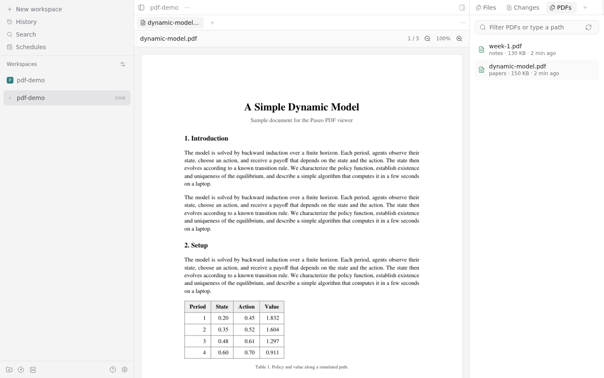

# Paseo PDF viewer

A [Paseo](https://paseo.sh) plugin that shows PDF files from a workspace, one tab per document, on desktop and mobile clients.



- **Explorer list (desktop):** a PDFs tab in the Explorer lists the workspace's PDFs, newest first. Click one to open it in its own tab; clicking an open document focuses its tab.
- **`/pdf [path]`:** with a path, opens that PDF; without one, shows the list. Paths can be workspace-relative, absolute, or `~/...`.
- **Phones:** the list opens as a regular tab, since the phone layout's Explorer has no plugin tabs.
- **Download:** saves the PDF to your device: a browser download on desktop and web, the share sheet on iOS (Save to Files, Mail, ...). Not available on Android, where React Native's share sheet only takes text.
- **Live reload:** an open PDF redraws when the file changes, so it works well next to `typst watch` or `latexmk -pvc`.

## Install

Plugins must be enabled on the daemon (Settings → Plugins, or `"pluginsEnabled": true` in the daemon's `config.json`).

Install the reviewed version from the [Paseo plugin directory](https://paseo.sh/plugins/tlamadon/pdf-viewer):

```sh
paseo plugin add tlamadon/pdf-viewer
```

Or install the latest code straight from GitHub:

```sh
paseo plugin add git:tlamadon/paseo-pdf-viewer
```

The daemon needs `npm` on its `PATH`: installation runs `npm ci` to fetch the `mupdf` WebAssembly package. Supported Paseo versions: `>=0.11.2 <0.13.0`.

## How it works

The daemon side opens PDFs with [MuPDF](https://mupdf.com/) compiled to WebAssembly and renders pages to PNG on demand, with small LRU caches for open documents and rendered pages. The client side uses React Native components only, so the same panels work in the desktop app, the web UI, and the mobile apps.

Paseo panels take no parameters and each panel id maps to one tab, so the plugin registers a panel per opened document at runtime. Registered panels also show up in the New tab menu, so the plugin keeps the list short: the last 10, stored in `$XDG_STATE_HOME/paseo-pdf-viewer/documents.json` (default `~/.local/state/...`).

Paseo resolves a restored tab's panel once, when the tab first renders, and does not re-check when a plugin registers the panel later. Restored tabs therefore need their panels registered synchronously during setup, before any RPC can answer. Desktop and web clients keep a copy of the list in `localStorage` for that; native apps have no synchronous storage, so after relaunching the iOS or Android app a restored PDF tab shows as unavailable until it is closed and reopened.

Paseo bundles plugin server code into a single evaluated script, which cannot carry MuPDF's ESM and `.wasm` files. `scripts/prepare.mjs` (run by the manifest's `build` step and by `npm install`) records the plugin's absolute path, and the server imports MuPDF from its own `node_modules` at runtime. If you move a local checkout, run `npm install` again.

## Development

```sh
git clone https://github.com/tlamadon/paseo-pdf-viewer
cd paseo-pdf-viewer
npm install
npm run typecheck
paseo plugin install "$PWD"
paseo plugin reload pdf-viewer   # after edits
```

## License

AGPL-3.0-or-later, matching MuPDF, which the plugin loads at runtime.
